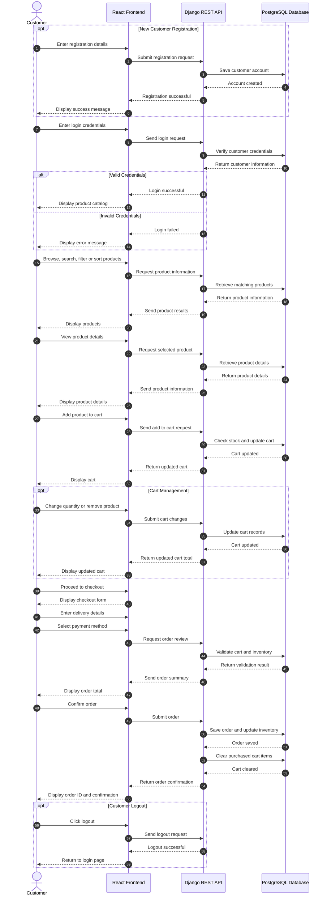
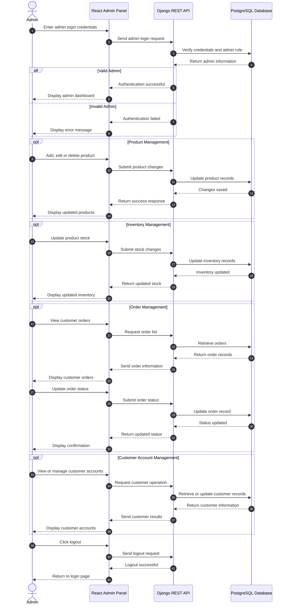

# E-Commerce Grocery Shop (Fresh Mart)
## UML Sequence Diagrams

**Course:** ITC 315 – Software Engineering Project  
**Project:** E-Commerce Grocery Shop (Fresh Mart)  
**Prepared by:** Sayeda Taiba Agha (Product Owner)

---

## 1. Customer Shopping Sequence Diagram

This sequence diagram shows the interactions between the customer, React frontend, Django REST API, and PostgreSQL database during registration, login, product browsing, cart management, and checkout.

---

## 2. Admin Panel Sequence Diagram

This sequence diagram shows the interactions between the administrator, React frontend, Django REST API, and PostgreSQL database for managing products, inventory, orders, and customer accounts.

---

## 3. Technologies Used

| Component | Technology | Purpose |
|---|---|---|
| Frontend | React | Customer and admin interfaces |
| Backend | Django | Application logic |
| API | Django REST Framework | Communication between frontend and backend |
| Database | PostgreSQL | Store users, products, carts, orders, and inventory |

---

## 4. Conclusion

The sequence diagrams show how the customer and administrator interact with the Fresh Mart system. They describe the communication between the frontend, backend, and database to complete the main operations of the grocery shop.

---

**Prepared by:** Sayeda Taiba Agha  
**Role:** Product Owner  
**Project:** E-Commerce Grocery Shop (Fresh Mart)
