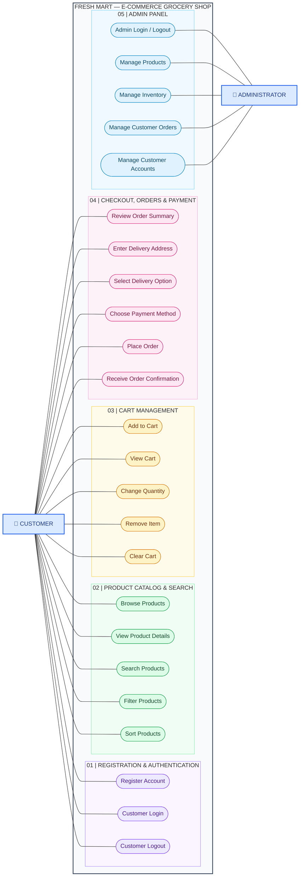

# Fresh Mart – UML Use Case Diagram

**Course:** ITC 315 – Software Engineering Project  
**Project:** E-Commerce Grocery Shop (Fresh Mart)  
**Prepared by:** Zohal Riaz (Scrum Master)

## 1. System Use Case Diagram

## 2. Actors

| Actor | Description |
|---|---|
| Customer | Registers, logs in, browses products, manages the cart, completes checkout, and places orders. |
| Administrator | Logs in to the admin panel and manages products, inventory, customer orders, and customer accounts. |

## 3. Covered Epics

| Epic | Features |
|---|---|
| Registration & Authentication | Register, login, logout |
| Product Catalog & Search | Browse, view details, search, filter, sort |
| Cart Management | Add, view, change quantity, remove, clear |
| Checkout, Orders & Payment | Review order, delivery address, delivery option, payment method, place order, confirmation |
| Admin Panel | Admin login/logout, product management, inventory management, order management, customer management |

## 4. Technologies Used

| Component | Technology |
|---|---|
| Frontend | React |
| Backend | Django |
| API | Django REST Framework |
| Database | PostgreSQL |

---

**Prepared by:** Zohal Riaz  
**Role:** Scrum Master

**Approved by:** Sayeda Taiba Agha  
**Role:** Product Owner 

**Project:** Fresh Mart – E-Commerce Grocery Shop
