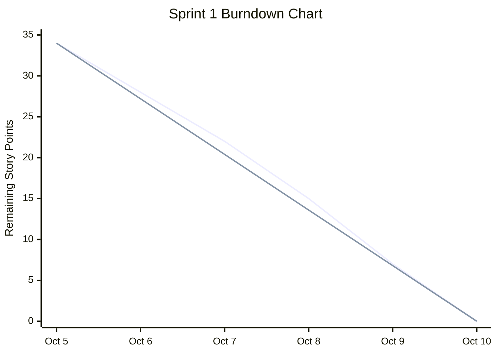

# Online Grocery Shop — Sprint 1 Burndown Report

## 1. Sprint Overview

| Item | Details |
|---|---|
| Sprint | Sprint 1 |
| Duration | October 5–10, 2026 |
| Sprint Goal | Develop customer account features and product catalog/search functionality |
| Product Owner | Sayeda Taiba Agha |
| Frontend Developer | Faezah Ahmadi |
| Backend Developer | Salma Rahman |
| Scrum Master | Zohal Riaz |
| Sprint Status | Completed |

## 2. Daily Progress

**Note:** The team confirmed that all planned Sprint 1 tasks were completed.

| Date | Day | Remaining Story Points | Work Completed |
|---|---:|---:|---|
| October 5 | 1 | 34 | Sprint planning and task setup |
| October 6 | 2 | 28 | Registration and login features |
| October 7 | 3 | 22 | Logout and authentication |
| October 8 | 4 | 15 | Product catalog and product details |
| October 9 | 5 | 7 | Search, filtering, and sorting |
| October 10 | 6 | 0 | Final testing and completion |

## 3. Sprint 1 Burndown Chart

The following chart compares illustrative remaining work with the ideal burndown line.

**Chart Data**

| Date | Illustrative Remaining Work | Ideal Remaining Work |
|---|---:|---:|
| October 5 | 34 | 34 |
| October 6 | 28 | 27.2 |
| October 7 | 22 | 20.4 |
| October 8 | 15 | 13.6 |
| October 9 | 7 | 6.8 |
| October 10 | 0 | 0 |

*The first line represents illustrative remaining work. The second line represents ideal remaining work.*

## 4. User Story Point Breakdown

**Total Estimated Story Points: 34**

| User Story | Description | Story Points |
|---|---|---:|
| US-01 | Customer Registration | 5 |
| US-02 | Customer Login | 4 |
| US-03 | Customer Logout | 3 |
| US-04 | Product Catalog | 5 |
| US-05 | Product Details | 4 |
| US-06 | Product Search | 5 |
| US-07 | Product Filtering | 4 |
| US-08 | Product Sorting | 4 |
| **Total** | | **34** |

*Story point values are proposed estimates and should be replaced if the team has official estimates.*

## 5. Sprint Analysis

- **Sprint Goal:** Achieved.
- **Task Completion:** All planned Sprint 1 tasks were completed, according to the team's confirmation.
- **Frontend Development:** Customer registration, login, logout, product catalog, product details, search, filtering, and sorting interfaces.
- **Backend Development:** Authentication, account storage, product retrieval, search, filtering, and sorting functionality.
- **Remaining Work:** 0 estimated Story Points at the end of the sprint.
- **Estimated Velocity:** 34 Story Points, assuming the proposed estimates are accepted by the team.
- **Challenges:** No specific challenges were reported in the information provided.

## 6. Conclusion

Sprint 1 focused on customer authentication and product discovery in the Online Grocery Shop. The team completed all planned tasks, including customer registration, login, logout, product catalog browsing, product details, search, filtering, and sorting.

Based on the illustrative burndown data, the remaining work reached zero by October 10, 2026. The Sprint Goal was achieved, and all planned tasks were completed.

**Prepared by:** Zohal Riaz
**Role:** Scrum Master  

