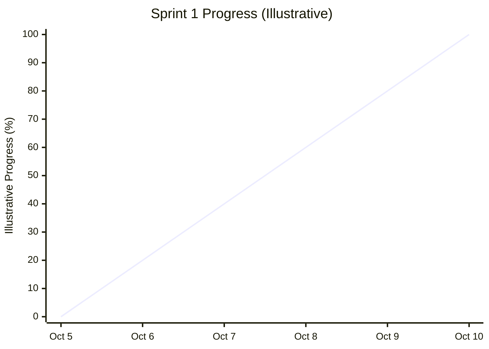

# Fresh Mart — Sprint 1 Burndown Report

## 1. Sprint Overview

| Item | Details |
|---|---|
| Sprint | Sprint 1 |
| Duration | October 5–10, 2026 |
| Sprint Goal | Complete customer registration, authentication, product catalog, product details, and search functionality |
| Product Owner | Sayeda Taiba Agha |
| Frontend Developer | Faezah Ahmadi |
| Backend Developer | Salma Rahman |
| Scrum Master | Zohal Riaz |
| Sprint Status | Completed |

## 2. Sprint 1 Daily Progress

The following table summarizes the team's reported activities throughout Sprint 1.

| Date | Day | Progress |
|---|---|---|
| October 5, 2026 | Day 1 | Sprint planning, task breakdown, and development setup |
| October 6, 2026 | Day 2 | Customer registration and login functionality |
| October 7, 2026 | Day 3 | Customer logout and authentication functionality |
| October 8, 2026 | Day 4 | Product catalog and product details |
| October 9, 2026 | Day 5 | Product search, filtering, and sorting |
| October 10, 2026 | Day 6 | Final testing, review, and sprint completion |

## 3. Sprint 1 Progress Chart

The chart below provides an illustrative overview of progress during Sprint 1. Daily remaining-work measurements were not recorded, so these percentages should not be interpreted as actual measured results.

## 4. Sprint 1 User Stories

Sprint 1 included eight User Stories across two Epics.

### Epic 1: Registration and Authentication

| User Story ID | User Story | Status |
|---|---|---|
| US-01 | Customer Registration | Completed |
| US-02 | Customer Login | Completed |
| US-03 | Customer Logout | Completed |

### Epic 2: Product Catalog and Search

| User Story ID | User Story | Status |
|---|---|---|
| US-04 | Product Catalog | Completed |
| US-05 | Product Details | Completed |
| US-06 | Product Search | Completed |
| US-07 | Product Filtering | Completed |
| US-08 | Product Sorting | Completed |

## 5. Sprint 1 Analysis

- **Sprint Goal:** Reported as achieved.
- **Planned User Stories:** 8.
- **Completed User Stories:** 8, according to the team's completion report.
- **Frontend Tasks:** Registration and login forms, logout control, product catalog interface, product details, search, filtering, and sorting.
- **Backend Tasks:** Registration and authentication logic, account storage in PostgreSQL, product retrieval, search, filtering, and sorting functionality.
- **Remaining Planned Work:** The team reported that all planned Sprint 1 tasks were completed.
- **Progress Tracking:** The chart is illustrative because daily remaining-work measurements were not provided.

## 6. Conclusion

Sprint 1 focused on customer registration, authentication, product catalog browsing, product details, search, filtering, and sorting.

According to the team's report, all eight planned User Stories were completed, and the Sprint Goal was achieved by October 10, 2026.

The progress chart provides a visual summary of the sprint timeline. It should not be treated as an actual burndown chart unless daily remaining-work data becomes available.

---

**Prepared by:** Zohal Riaz

