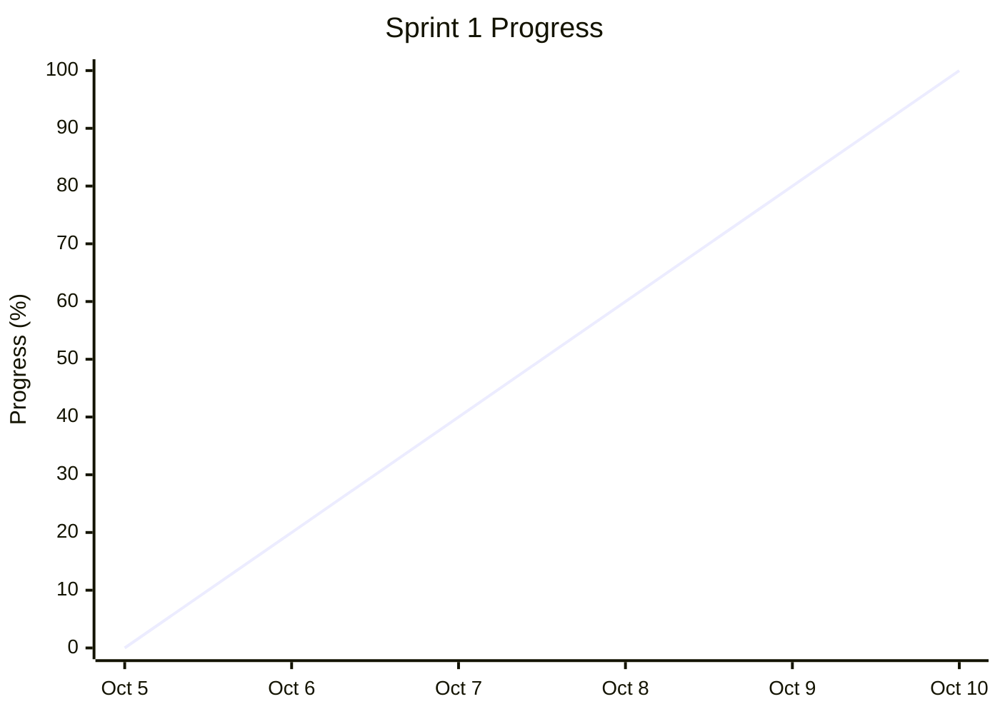

# Online Grocery Shop — Sprint 1 Burndown Report

## 1. Sprint Overview

| Item | Details |
|---|---|
| Sprint | Sprint 1 |
| Duration | October 5–10, 2026 |
| Sprint Goal | Complete customer registration, authentication, product catalog, and search functionality |
| Product Owner | Sayeda Taiba Agha |
| Frontend Developer | Faezah Ahmadi |
| Backend Developer | Salma Rahman |
| Scrum Master | Zohal Riaz |
| Sprint Status | Completed |

## 2. Sprint 1 Daily Progress

The team confirmed that all planned Sprint 1 tasks were completed. The table summarizes the work completed during this sprint.

| Date | Day | Progress |
|---|---|---|
| October 5 | Day 1 | Sprint planning and task setup |
| October 6 | Day 2 | Customer registration and login |
| October 7 | Day 3 | Customer logout and authentication |
| October 8 | Day 4 | Product catalog and product details |
| October 9 | Day 5 | Product search, filtering, and sorting |
| October 10 | Day 6 | Final testing and completion |

## 3. Sprint 1 Burndown Chart

The chart below illustrates the progress of Sprint 1 across its six days. Since recorded daily remaining-work measurements were not provided, the chart uses a qualitative progress scale rather than estimated Story Points.

*Note: This is an illustrative progress chart, not a measured burndown chart. Replace the values with actual daily progress records if available.*

## 4. Sprint 1 User Stories

Sprint 1 includes eight User Stories across two Epics.

### Epic 1: Registration

| User Story ID | User Story | Status |
|---|---|---|
| US-01 | Customer Registration | Completed |
| US-02 | Customer Login | Completed |
| US-03 | Customer Logout | Completed |

### Epic 2: Catalog / Search

| User Story ID | User Story | Status |
|---|---|---|
| US-04 | Product Catalog | Completed |
| US-05 | Product Details | Completed |
| US-06 | Product Search | Completed |
| US-07 | Product Filtering | Completed |
| US-08 | Product Sorting | Completed |

## 5. Sprint 1 Analysis

- **Sprint Goal:** Achieved.
- **User Stories Planned:** Eight.
- **User Stories Completed:** Eight, according to the team's confirmation.
- **Frontend Tasks:** Registration and login forms, logout control, catalog interface, product details, search, filtering, and sorting.
- **Backend Tasks:** Registration logic, authentication, PostgreSQL account storage, product retrieval, search, filtering, and sorting functionality.
- **Remaining Tasks:** None of the planned Sprint 1 tasks remain incomplete, according to the team's confirmation.

## 6. Conclusion

Sprint 1 focused on customer registration, login, logout, product catalog browsing, product details, search, filtering, and sorting.

All eight planned User Stories were reported as completed by the team. The Sprint Goal was achieved by the end of the sprint on October 10, 2026.

---

**Prepared by:** Zohal Riaz  

**Role:** Scrum Master

