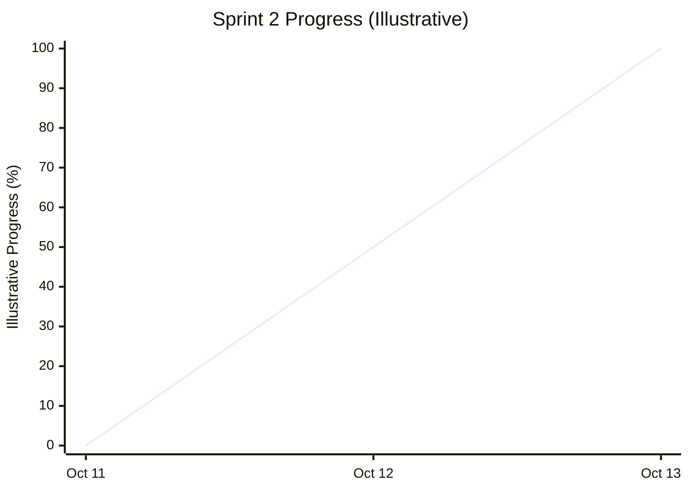

# Fresh Mart — Sprint 2 Burndown Report

## 1. Sprint Overview

| Item | Details |
|---|---|
| Project | E-Commerce Grocery Shop (Fresh Mart) |
| Course | ITC 315 – Software Engineering Project |
| Sprint | Sprint 2 |
| Epic | Cart Management |
| Duration | October 11–13, 2026 |
| Sprint Goal | Implement a fully functional cart management system that allows customers to add products, manage quantities, remove items, clear the cart, and view the total price |
| Product Owner | Sayeda Taiba Agha |
| Frontend Developer | Faezah Ahmadi |
| Backend Developer | Salma Rahman |
| Scrum Master | Zohal Riaz |
| Sprint Status | Completed |

## 2. Sprint 2 Daily Progress

Sprint 2 focused on implementing and integrating the cart management functionality. The following table summarizes the sprint activities based on the planned work and the final Sprint Review.

| Date | Day | Planned / Reported Activities |
|---|---|---|
| October 11, 2026 | Day 1 | Sprint planning, task assignment, and development of Add to Cart and View Shopping Cart functionality |
| October 12, 2026 | Day 2 | Implementation of quantity management, product removal, Clear Cart functionality, and cart total calculations |
| October 13, 2026 | Day 3 | Frontend and backend integration, functional testing, bug fixing, final review, and acceptance of the six User Stories |

## 3. Sprint 2 Progress Chart

The following chart illustrates the overall progression of Sprint 2 across its three days. The percentages are illustrative and are not based on recorded daily remaining-work measurements.

## 4. Sprint 2 User Stories and Completion Status

Sprint 2 included six User Stories under the Cart Management Epic. According to the Sprint 2 Review Report, all six User Stories were completed and accepted by the Product Owner.

| User Story ID | User Story Title | Assigned Developers | Status |
|---|---|---|---|
| US-09 | Add Product to Cart | Faezah Ahmadi / Salma Rahman | Completed |
| US-10 | View Shopping Cart | Faezah Ahmadi / Salma Rahman | Completed |
| US-11 | Change Quantity | Faezah Ahmadi / Salma Rahman | Completed |
| US-12 | Remove Product | Faezah Ahmadi / Salma Rahman | Completed |
| US-13 | Clear Cart | Faezah Ahmadi / Salma Rahman | Completed |
| US-14 | View Cart Total | Faezah Ahmadi / Salma Rahman | Completed |

## 5. Development Tasks Completed

### 5.1 Frontend Development

**Assigned to:** Faezah Ahmadi

The following frontend tasks were included in the Sprint 2 plan and reported as completed in the Sprint Review:

- Implemented the Add to Cart button on product cards and product detail pages.
- Updated the cart interface to reflect added products.
- Developed the shopping cart page to display product information, prices, quantities, and subtotals.
- Added quantity controls to increase or decrease product quantities.
- Implemented individual product removal.
- Added the Clear Cart option.
- Displayed the cart total and updated the displayed amounts when cart contents changed.
- Added user feedback messages for cart actions and invalid quantity entries.

### 5.2 Backend Development

**Assigned to:** Salma Rahman

The following backend tasks were included in the Sprint 2 plan:

- Implemented cart and cart-item data handling in Django.
- Developed API functionality for adding products to the cart.
- Retrieved the logged-in customer's cart and its product details.
- Implemented quantity updates with validation.
- Added API functionality to remove individual cart items.
- Implemented functionality to clear the cart.
- Calculated item subtotals and the overall cart total.
- Included stock and quantity validation to prevent invalid cart operations.

### 5.3 Integration and Testing

**Assigned to:** Faezah Ahmadi and Salma Rahman

- Connected frontend cart actions to the backend APIs.
- Checked cart operations and product quantity management.
- Tested cart total and subtotal calculations.
- Verified removal of individual products and clearing of the cart.
- Ran automated tests and reviewed the cart functionality.
- Addressed the reported login email-validation issue from Sprint 1.

According to the Sprint 2 Review Report, 24 automated tests passed and no automated tests failed.

## 7. Acceptance Criteria and Product Owner Review

The Product Owner reviewed all six Cart Management User Stories.

| User Story | Acceptance Result |
|---|---|
| Add Product to Cart | Accepted |
| View Shopping Cart | Accepted |
| Change Quantity | Accepted |
| Remove Product | Accepted |
| Clear Cart | Accepted |
| View Cart Total | Accepted |

The Sprint Review records that all six User Stories were accepted. The completed functionality allows customers to manage cart contents, update quantities, remove products, clear the cart, and review the total amount before checkout.

## 8. Sprint 2 Analysis

- **Sprint Goal:** Achieved according to the Sprint Review.
- **Planned User Stories:** 6.
- **Completed User Stories:** 6.
- **Accepted User Stories:** 6.
- **Frontend Work:** Cart interface, quantity controls, product removal, Clear Cart, total display, and user feedback.
- **Backend Work:** Cart APIs, cart-item operations, quantity validation, stock checks, and price calculations.
- **Testing:** 24 automated tests passed, with no automated test failures reported.
- **Outstanding Quality Issue:** The detailed review records one minor bug and one open bug, which should be checked before being described as fully resolved.
- **Progress Tracking:** The chart is illustrative because daily remaining-work data was not recorded.

## 9. Preparation for Sprint 3

Following Sprint 2, the next sprint focused on Payment / Checkout and Orders.

| User Story ID | User Story Title |
|---|---|
| US-11 | Contact Information |
| US-12 | Shipping Information |
| US-13 | Delivery Options |
| US-14 | Payment Information |
| US-15 | Review Order |
| US-16 | Place Order |
| US-17 | Order Confirmation |
| US-27 | Order History |

## 10. Conclusion

Sprint 2 focused on delivering the Cart Management functionality for Fresh Mart. The planned scope included adding products to the cart, viewing cart contents, changing quantities, removing products, clearing the cart, and viewing the total price.

According to the Sprint 2 Review Report, all six planned User Stories were completed and accepted by the Product Owner. The review also records 24 successful automated tests and no automated test failures.

The sprint was reported as completed on October 13, 2026. One minor bug and one open bug were also recorded in the detailed quality assessment and should be verified against the testing records.

---

**Prepared by:** Zohal Riaz  
**Role:** Scrum Master  
**Project:** Fresh Mart — E-Commerce Grocery Shop  
**Sprint:** Sprint 2 — Cart Management  
**Report Date:** October 13, 2026

