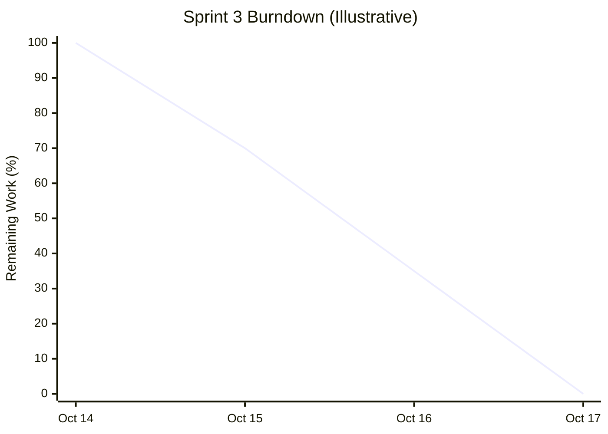

# Fresh Mart — Sprint 3 Burndown Report

---

## 1. Sprint Overview

| Item | Details |
|---|---|
| Project | E-Commerce Grocery Shop (Fresh Mart) |
| Course | ITC 315 – Software Engineering Project |
| Sprint | Sprint 3 |
| Epic | Payment / Checkout + Orders |
| Duration | October 14–17, 2026 |
| Sprint Goal | Implement and integrate checkout, payment information, order placement, order confirmation, and order history functionality |
| Product Owner | Sayeda Taiba Agha |
| Frontend Developer | Faezah Ahmadi |
| Backend Developer | Salma Rahman |
| Scrum Master | Zohal Riaz |

---

## 2. Sprint 3 Daily Progress

Sprint 3 focused on implementing the checkout and order management functionality for Fresh Mart. The team worked on frontend development, backend API implementation, integration, testing, documentation, and bug fixing.

| Date | Day | Planned / Reported Activities |
|---|---|---|
| October 14, 2026 | Day 1 | Sprint planning, task assignment, and development of checkout and order-related features |
| October 15, 2026 | Day 2 | Implementation of checkout forms, contact information, shipping address, delivery and payment sections, order review, and backend documentation |
| October 16, 2026 | Day 3 | Completion of frontend functionality, backend API integration, testing preparation, and documentation |
| October 17, 2026 | Day 4 | Completion of integration testing, bug fixing, final review, and test reporting |

---

## 3. Sprint 3 Burndown Chart

The following chart illustrates the estimated reduction in remaining work throughout Sprint 3. The values are illustrative because actual daily remaining-work measurements were not provided.

## 4. Sprint 3 User Stories and Completion Status

Sprint 3 included eight User Stories under the Payment / Checkout + Orders Epic.

| User Story ID | User Story Title | Assigned Developers | Development Status |
|---|---|---|---|
| US-11 | Contact Information | Frontend + Backend | Completed |
| US-12 | Shipping Information | Frontend + Backend | Completed |
| US-13 | Delivery Options | Frontend | Completed |
| US-14 | Payment Information | Frontend + Backend | Completed |
| US-15 | Review Order | Frontend + Backend | Completed |
| US-16 | Place Order | Backend | Completed |
| US-17 | Order Confirmation | Frontend + Backend | Completed |
| US-27 | Order History | Frontend + Backend | Completed |

## 5. Development Tasks Completed

### 5.1 Frontend Development — Faezah Ahmadi

- Implemented the contact information section in checkout.
- Added functionality to prefill customer information from account details where available.
- Developed the shipping information form.
- Implemented delivery options and delivery selection.
- Developed the payment information section and frontend validation.
- Created the order review section.
- Connected cart information with the checkout process.
- Implemented the order confirmation page, including order number, status, and summary.
- Added handling for failed order submissions.
- Developed the order history page.
- Displayed order dates, statuses, totals, and purchased items.
- Integrated the frontend checkout workflow with the backend API.
- Tested the integrated functionality and resolved issues identified during testing.

### 5.2 Backend Development — Salma Rahman

- Implemented validation for customer contact information.
- Stored contact information with the relevant order data.
- Implemented validation and storage of shipping information.
- Connected shipping data to the checkout API.
- Validated the selected delivery option and included it in the order.
- Implemented payment information handling and validation within the project scope.
- Added checks to ensure checkout information was complete.
- Implemented the Place Order API.
- Implemented order saving and inventory updates after successful order placement.
- Added protection against duplicate order submissions.
- Implemented cart clearing after a successful purchase.
- Implemented order retrieval functionality for authenticated customers.
- Ensured customers could retrieve only their own orders.
- Prepared backend testing documentation and supported frontend/backend integration.
- Helped identify and resolve integration issues.

### 5.3 Integration and Testing

- Connected the checkout frontend to the backend API.
- Tested contact and shipping information.
- Checked delivery and payment information workflows.
- Tested order review and order placement.
- Checked order confirmation and order history functionality.
- Identified and fixed bugs during integration testing.
- Reviewed the complete checkout workflow.
- Prepared test documentation and summarized testing results.

---

## 8. Sprint 3 Progress Analysis

Sprint 3 focused on completing the checkout and order management functionality of Fresh Mart.

According to the team's final progress updates :

- All eight planned user stories were reported as development-complete.
- The frontend checkout workflow was integrated with the backend API.
- Integration testing and bug fixing were completed.
- The team prepared testing documentation and reviewed the implemented functionality.
- No unresolved major blocker was reported in the final daily Scrum update.
- Product Owner review and acceptance remained pending.

---

## 10. Conclusion

Sprint 3 development for Fresh Mart was reported as completed on October 17, 2026. The team implemented the planned checkout and order management functionality, integrated the frontend with the backend API, completed integration testing and bug fixing, and prepared the relevant test documentation.
The development increment was ready to be presented to the Product Owner.
The sprint established the checkout and order management functionality needed for the next stage of the Fresh Mart project.

---

## Report Prepared By

**Name:** Zohal Riaz  
**Role:** Scrum Master  
**Project:** Fresh Mart – E-Commerce Grocery Shop  
**Course:** ITC 315 – Software Engineering Project  
**Sprint:** Sprint 3 — Payment / Checkout + Orders  
**Report Date:** October 17, 2026

